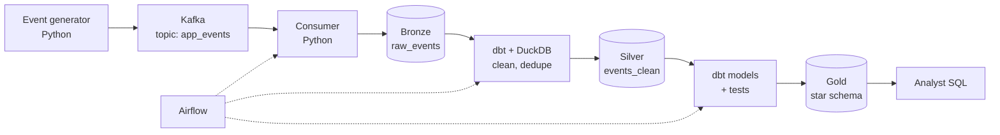

# App Log Lakehouse

An end-to-end data pipeline that turns raw application event logs into a trusted, analytics-ready star schema, built on a **medallion lakehouse** (bronze → silver → gold) with **Kafka**, **DuckLake**, **dbt**, and **Airflow**.

> 🚧 **Status:** in progress. Sprint 1 (setup) and Sprint 2 (ingestion) are underway. See [Roadmap](#-roadmap).

---

## 📌 Problem

A mobile and web app logs every user action separately: opening the app, searching, viewing an item, adding to cart, checking out, purchasing. The raw logs are messy (duplicates, missing user IDs, late events, inconsistent formats) and analysts can't answer business questions from them directly.

**Goal:** build a pipeline that ingests the raw events, cleans them, and models them into a star schema that answers questions like *"What is our conversion funnel by device?"* and *"How many new users come back within 7 days?"*

---

## 🏗️ Architecture



| Layer | What it holds | Written by |
|---|---|---|
| **Bronze** | Raw events exactly as received (all fields as strings + original JSON + Kafka metadata). Append-only, never edited. | Python consumer via `pyducklake` |
| **Silver** | Cleaned events: deduplicated, typed timestamps, standardized values, invalid rows flagged | dbt |
| **Gold** | Star schema (facts + dimensions) for analytics | dbt |

All three layers live in a single **DuckLake** catalog (Parquet data files + SQL metadata catalog), which gives ACID transactions, snapshots, and time travel.

### Key design decisions
- **ELT, not ETL:** land raw data first, transform inside the lakehouse. Bronze can always be replayed.
- **Bronze stores strings only:** a malformed timestamp can never break ingestion. Parsing happens in silver.
- **At-least-once delivery:** Kafka offsets are committed only *after* a batch is written to bronze. Possible duplicates are removed in silver by `event_id`.
- **Idempotent reruns:** each pipeline run processes one date. Rerunning a date overwrites it instead of appending duplicates.
- **Single-node first:** at this data volume, DuckDB is faster and far lighter than Spark. A Spark + Iceberg version is planned as v2 for comparison (see [Roadmap](#-roadmap)).

---

## 🧰 Tech stack

| Purpose | Tool | Version |
|---|---|---|
| Language | Python | 3.12 / 3.13 |
| Event streaming | Apache Kafka (KRaft mode, no ZooKeeper) | 4.4.0 |
| Kafka client | confluent-kafka | 2.16.2 |
| Lakehouse format | DuckLake via pyducklake | 1.0.19 |
| Query engine | DuckDB | 1.5.6 |
| Columnar data | PyArrow | 26.0.1 |
| Transformation & tests | dbt-duckdb | 1.11.1 |
| Orchestration | Apache Airflow | 3.4.0 |
| Containers | Docker Compose | — |

> ⚠️ `duckdb` is pinned to **1.5.6** because `pyducklake` requires that exact version. Do not upgrade to DuckDB 2.x.

---

## 📁 Project structure

```
app-log-lakehouse/
├── docker-compose.yml            # Kafka (KRaft) + Kafka UI
├── requirements.txt
├── generator/
│   └── produce_events.py         # simulates app events (with dirty data) → Kafka
├── ingestion/
│   └── consume_to_bronze.py      # Kafka → bronze.raw_events (DuckLake)
├── dbt/
│   ├── models/staging/           # bronze → silver
│   ├── models/marts/             # silver → gold star schema
│   └── tests/
├── airflow/
│   └── dags/app_log_pipeline.py
├── analysis/
│   └── analyst_questions.sql     # the 5 business questions
├── notebooks/                    # exploration + time travel demo
├── docs/
│   └── architecture.png
└── README.md
```

---

## 🧾 Data

### Raw event schema

| Field | Type | Description |
|---|---|---|
| `event_id` | string (UUID) | Unique event ID, used for deduplication |
| `user_id` | string | User who performed the action |
| `session_id` | string | Groups events within one visit |
| `event_type` | string | `app_open`, `search`, `view_item`, `add_to_cart`, `remove_from_cart`, `checkout`, `purchase` |
| `item_id` | string (nullable) | Item involved (item events only) |
| `price` | decimal (nullable) | Purchase price (purchase events only) |
| `device` | string | `ios`, `android`, `web` |
| `country` | string | ISO country code |
| `event_ts` | timestamp | When the action happened |

### Intentional data quality issues

The generator injects realistic problems so the pipeline has real cleaning work to do:

| Issue | Rate | Handled in |
|---|---|---|
| Duplicate events (same `event_id`) | ~2% | Silver: dedupe by `event_id` |
| Null `user_id` | ~1% | Silver: flagged / excluded from user metrics |
| Late-arriving events | ~1% | Silver: placed by `event_ts`, not arrival time |
| Mixed timestamp formats (ISO, `YYYY/MM/DD`, epoch) | random | Silver: parsed into one `TIMESTAMP` type |
| Inconsistent casing in `event_type` | random | Silver: lowercased |

### Gold star schema

- **`fact_events`**: grain is one row per event. Keys: `event_id`, `user_key`, `item_key`, `date_key`. Measures: `revenue`, `is_purchase`
- **`dim_user`**: `user_id`, `first_seen_date`, `country`, `first_device` (SCD type 1)
- **`dim_item`**: `item_id`, `category`, `list_price`
- **`dim_date`**: `date_key`, `date`, `day_of_week`, `week`, `month`, `is_weekend`
- **`fct_sessions`** (optional): `session_id`, `user_key`, `start_ts`, `end_ts`, `n_events`, `converted`

---

## ❓ Business questions answered

1. **DAU / WAU:** daily and weekly active users over time
2. **Conversion funnel:** view_item → add_to_cart → purchase, split by device
3. **Top items:** top 10 items by revenue per week
4. **Engagement:** average session length and events per session
5. **D7 retention:** % of new users who return within 7 days

Queries live in [`analysis/analyst_questions.sql`](analysis/analyst_questions.sql).

---

## 🚀 Getting started

### Prerequisites
- Docker + Docker Compose
- Python 3.12 or 3.13
- Internet access on first run (DuckDB downloads the `ducklake` extension once)

### 1. Install Python dependencies
```bash
python -m venv .venv
source .venv/bin/activate          # Windows: .venv\Scripts\activate
pip install -r requirements.txt
```

### 2. Start Kafka
```bash
docker compose up -d
docker compose ps                  # wait until kafka is "healthy"
```
Kafka UI is available at http://localhost:8080.

### 3. Create the topic
```bash
docker exec -it kafka /opt/kafka/bin/kafka-topics.sh \
  --bootstrap-server localhost:9092 \
  --create --topic app_events --partitions 3 --replication-factor 1
```

### 4. Generate 7 days of historical events
```bash
python generator/produce_events.py --mode backfill --days 7
```

### 5. Load events into bronze
```bash
python ingestion/consume_to_bronze.py --exit-when-idle 15
```

### 6. (Optional) Stream live events
```bash
python generator/produce_events.py --mode live --rate 20
python ingestion/consume_to_bronze.py
```

### 7. Build silver and gold *(Sprint 3)*
```bash
cd dbt && dbt build
```

### 8. Run the whole pipeline with Airflow *(Sprint 4)*
_Coming soon._

---

## 🕰️ Time travel demo

Every batch written to DuckLake is a commit that creates a new **snapshot**, so you can query any table as it was in the past:

- `table.snapshots()` lists every snapshot with its commit message
- `table.scan().with_snapshot(<id>)` reads the table at an older snapshot
- `... FROM bronze.raw_events AT (VERSION => <id>)` is the same thing in SQL
- `table.table_insertions(start_snapshot=..., end_snapshot=...)` shows exactly which rows a load added

_Screenshots: coming soon (`docs/`)._

---

## 📊 Results

_To be filled in with real numbers after Sprint 3._

| Metric | Value |
|---|---|
| Events generated (7 days) | _TBD_ |
| Duplicate / invalid records removed in silver | _TBD_ |
| dbt models / data tests | _TBD_ |
| End-to-end pipeline runtime | _TBD_ |

---

## 🗺️ Roadmap

**v1: single-node lakehouse**
- [ ] **Sprint 1:** repo setup, Kafka (KRaft) with Docker Compose, event generator
- [ ] **Sprint 2:** Kafka → bronze ingestion in DuckLake, time travel demo
- [ ] **Sprint 3:** silver cleaning + gold star schema with dbt, data tests, answer the 5 questions
- [ ] **Sprint 4:** Airflow DAG orchestrating ingest → dbt build, idempotent reruns
- [ ] **Sprint 5:** architecture diagram, results, polish

**v2: scale-out version (planned)**
- [ ] Spark Structured Streaming: Kafka → bronze in near real time
- [ ] Rebuild on Apache Iceberg (+ MinIO + Trino) and compare with DuckLake
- [ ] Benchmark v1 vs v2 (runtime, memory, setup effort)
- [ ] Dashboard (Streamlit / Evidence / Superset)
- [ ] GitHub Actions CI running `dbt build` on every push

---

## 💡 What I learned

_To be written at the end: what broke, what I'd do differently, and what would change at 100× the data volume._

---

## 👤 Author

**[Your name]** · [Your program, university]
<!-- Add GitHub / LinkedIn / email here -->